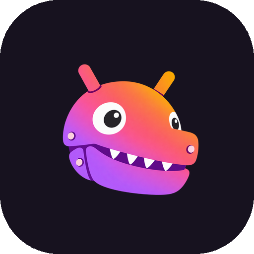
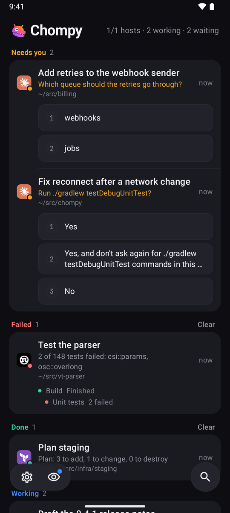
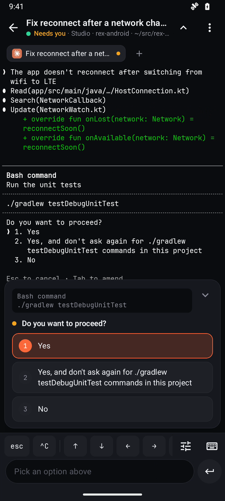
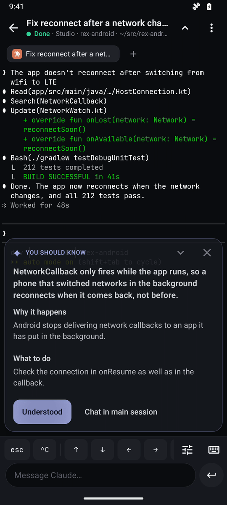

# Chompy, a client for Rex

<p align="center"></p>

An unofficial Android client for [Rex](https://www.superlogical.com), Superlogical's multiplexer.
It shows what your agents are doing on every machine at once, and opens a real terminal,
running the same engine as the Rex server, when one of them needs you.

<p align="center">
  
</p>
<p align="center"><sub>
  48 seconds, unedited, on an emulator (<a href="docs/media/agent-board.mp4">MP4, 720p</a>).
  The agents are scripts that report with OSC 7501; the server, the app and the taps are real.
  <a href="docs/demo">How it was recorded.</a>
</sub></p>

## Get it

- **[GitHub's releases](https://github.com/jeffarese/chompy/releases/latest).** Install the APK; from
  then on the app finds new versions there itself and offers them on Home.
- **Google Play**, once it is through Google's testing and review. Play will keep that one up to date.

Both are signed with the same key, so you'll be able to move from one to the other without
uninstalling. To check an APK is Chompy's, `apksigner verify --print-certs chompy-<version>.apk`
should print this SHA-256 for the certificate:

```
64:03:CD:23:09:07:AF:16:1F:18:22:B7:1B:DA:99:31:64:A5:C2:CB:84:7C:08:C1:84:F0:36:C3:89:2A:59:4A
```

You need a [Rex](https://www.superlogical.com) server of your own that the phone can reach, for example
over Tailscale, and a phone with a 64-bit ARM processor on Android 8 or later.

## On a phone, the agents come first

A phone is a poor place to type into a terminal and a good place to keep an eye on work. So Home
opens on a board of every agent on every host, ordered by what needs a person, with the tabs below
it. The board is hidden until some program reports a status, so a host with none looks the same as
before.

| Group | What is in it | Leaves when |
|---|---|---|
| **Needs you** | Blocked agents, with what they want: permission, a question or a password. Also a bell or notification with no status. Longest waiting first. | It's answered |
| **Failed** | Agents that report `error`, newest first | You've looked, or cleared it |
| **Done** | Agents that report `done`, newest first | You've looked, or cleared it |
| **Working** | Running agents, with progress when they report it | They stop |

A tap opens the terminal at that exact pane. When Claude Code asks for permission or asks a
question, its card offers the answers its notification would, three at most, so one tap answers
it from Home.
Finished and failed cards clear with a swipe, or a whole group with Clear, with Undo either way.

The board follows the [OSC 7501 program status protocol](https://www.superlogical.com/rex/docs/build/program-status)
rather than guessing from the screen:

- **A status comes from the program.** `state`, `kind`, `progress`, `title` and `msg` come from the
  program itself. Nothing reads spinners off the screen or diffs output to decide what an agent is
  doing.
- **Done means "waiting for review".** The spec keeps `done` and `error` until the user has seen
  them. The app remembers, per pane, the last result you looked at. An agent that finished while
  the phone was asleep, offline or not yet started still shows as new, and one you've opened stays
  seen after a restart.
- **Subtasks belong to their agent.** Records such as `build` and `build/test` under a root record
  show as lines under it, nested by depth. Only the agent's own state raises a banner or a
  notification, so a finished build step doesn't.
- **Every card says where it runs.** The title and message come from the program. The session and
  folder under them come from the host, so one program can't pass for an agent in another terminal.
- **Cards keep their place.** Working agents are ordered by name, not by their last report, so
  progress doesn't reshuffle them. A card that changes group slides there, and the tab list below
  moves with it.
- **A host that drops out is shown as unreachable.** Its tabs fade with the reason, and its agents
  leave the board instead of claiming to still be working.
- **Answers come from the screen, and are checked again.** OSC 7501 says what an agent waits for,
  not what the choices are, so the answers come from Claude Code's prompt on its screen, read the
  way the terminal reads it. Before pressing one, the app reads the screen again, and presses
  nothing if the question, the command or the options have changed.

<p align="center">
  
  
  
</p>

## The terminal is the server's terminal

The phone runs [libghostty-vt](https://github.com/ghostty-org/ghostty) at the same Ghostty commit as
the Rex server ([`GHOSTTY_COMMIT`](terminal/native/GHOSTTY_COMMIT)), through a small JNI bridge
([`rexterm.c`](terminal/src/main/cpp/rexterm.c)) under Termux's view. The phone and the server parse
the same bytes with the same code, and a fresh stream restores the server's own Ghostty snapshot
instead of redrawing it.

Keys go through libghostty-vt's key encoder too, set from the modes the program has turned on. A
program that uses the Kitty keyboard protocol, as Claude Code does, gets keys in that form, so
Shift+Enter (the key bar's shift, then ⏎) starts a new line instead of sending the message. A shell
gets the bytes it always has. The phone sends what Ghostty on the desktop would.

Measured on an emulator and against a live server ([full results](docs/perf/results.md)):

| | |
|---|---:|
| First screen of a pane with 14,000 lines of history, over a 48 KB/s link | 1.5 s |
| Rows that differ from the server's screen, on a corpus of hard cases | 0 of 26 |
| Modes that differ from the server's, Kitty keyboard flags included | 0 |
| Parsing Unicode-heavy output, on the emulator | 100 MB/s |
| Parsing plain ASCII, on the emulator | 124 MB/s |
| 14,000 rows of 150-column history | 6.7 MB, compressed, outside the Java heap |

Scrolling happens on the phone. History is local, so a drag needs no network and no repaint from
the host. Claude Code's fullscreen renderer keeps no history, so scrolling it means sending wheel
events and waiting for Claude to redraw. Measured live, that trails the finger by 0.5 to 3.5 lines.
When the phone sees fullscreen Claude, it offers to resume that one conversation in the classic
renderer, keeping its mode and effort and leaving your settings alone. Measured the same way, the
classic renderer stays within 0.03 lines of the finger.

### Why part of Termux is still here

Everything that decides what the terminal holds or sends is Ghostty's: parsing, the screen and
its history, modes, and keys. What's left of [Termux](https://github.com/termux/termux-app)
(v0.118.1, Apache 2.0) is the Android side, about 3,200 lines: the view that draws the cells on a
`Canvas`, its touch gestures and scrolling, the soft keyboard connection, and text selection.

That part stays because libghostty-vt doesn't draw. It holds a terminal's state and hands it to a
renderer of the app's own. Ghostty's renderers are part of the Ghostty app: Metal on macOS, and
OpenGL 4.3 on Linux, which Android's OpenGL ES isn't. Without one, an Android app needs its own
view, and Termux's is well tried on phones and their keyboards. If libghostty offers a renderer an
Android app can use, the view can go too. [`terminal/NOTICE.md`](terminal/NOTICE.md) lists what
changed from Termux.

## Made for the networks phones are actually on

Most of the work went into links that are slow or flaky, or that change mid-stream:

- **Slow links don't drop streams.** On mobile data, a long conversation never loaded: while the
  server pushed a 2.35 MB snapshot, its answer to the phone's ping waited behind it and missed the
  deadline. The server then dropped the stream, and every retry started again from zero. Data
  connections no longer send pings; the server sends its own. `LiveSlowLinkTest` streams 3 MB at
  10 KB/s and stays live.
- **The screen comes before the history.** If a fresh stream's snapshot hasn't finished after a
  second, the app reads the current screen over the control connection, which is compressed, and
  shows it while the history catches up: 1.5 s instead of 28 s at 48 KB/s.
- **Input waits until the screen is current.** Keys and Send are held, dimmed, while a pane is
  loading or its host is away, so nothing is typed into a screen you can't see.
- **A network change is noticed at once.** Moving from Wi-Fi to cellular checks every host
  immediately instead of waiting for a ping to fail, and so does one while the app is away, with
  Notify when away on.
- **Away, an unreachable host is tried less often.** A laptop asleep overnight is tried at longer
  and longer intervals, up to five minutes apart, and not at all without a network, so it doesn't
  keep the phone's radio up. Coming back to the app, or a network coming back, tries at once.
- **Coming back is instant.** Live streams survive a switch away and back. After a longer absence,
  terminals keep their last screen while the stream resumes (the server holds it for 60 s).
- **Events missed while away are recovered.** After a reconnect, every pane's status, title,
  process and folder is read again, and a change that happened meanwhile alerts as if it had been
  seen live.
- **Settings › Connection keeps a log of each return**: how long the app was away, which hosts
  answered, and how each terminal came back.

## Native to Android

Built with Jetpack Compose and Material 3. Where Android has its own way of doing something, the
app uses it:

- Notifications for agents that need you, finish or fail, through a foreground service you opt into
  (the welcome offers it, and Settings › Alerts). Needs you pops up; finished and failed agents and
  programs' own notifications have channels of their own, so Android's settings can quiet one and
  not the others. A pane that alerts again within 30 s updates its notification without a sound,
  unless the news is more urgent: Claude needing you just after it finished still sounds.
  Each one opens its pane, Claude's prompts can be answered from it once the phone is unlocked, and
  the Settings page says when notification permission or battery limits would stop them.
- Back closes search before it leaves the app, and a quick double tap opens one screen, not two.
  On Android 14 and later, a back swipe shows the screen underneath before you let go.
- A long press on the app's icon offers the last four panes you opened.
- Pairing scans the code from `rex server tailscale pair`, in the welcome or when adding a host,
  and checks Tailscale is up before trying a tailnet address.
- While an agent works, the screen stays on until ten minutes after your last touch, then sleeps
  as the phone would (Settings › Terminal).
- TalkBack reads each card's and tab's state, such as "Needs you, waiting for permission, 4
  minutes ago". Dimmed text reads at 4.5:1 or more in every theme, and the key bar, tabs and
  Claude's strip take 48 dp touches without growing.
- Shell panes get a keyboard without autocapitalisation or autocorrect. A key bar with sticky Shift
  and arrows can be rearranged in Settings, as can Claude's strip.
- The system's own copy confirmation on Android 13 and later, and landscape layouts that keep clear
  of cutouts.
- Installed from GitHub, the app updates itself from its releases there. Every few hours, closed or
  not, it looks for a new version and downloads it on Wi-Fi; on Android 12 and later it installs it by
  itself once you have been away from the app a minute or more, or as long as it keeps your place if
  that is longer. A download installs only if its SHA-256 matches, it is Chompy, it is newer, and it
  is signed with the same key. Installed from Google Play, Play updates it, and the app has no updater
  of its own.

Each program in a tab shows its own logo on its brand's colour, from [Simple Icons](https://simpleicons.org)
(CC0), [Lobe Icons](https://github.com/lobehub/lobe-icons) (MIT) and [Iconify's logos](https://github.com/gilbarbara/logos)
(CC0) or the project's own repository, with [Lucide](https://lucide.dev) (ISC) glyphs for generic
programs and ones whose logo isn't free to use ([`art/glyphs`](art/glyphs) lists each one's source and [license](art/glyphs/GLYPH-LICENSES.txt)). Settings › Look has all 41 of Rex's themes.

## Measured, not assumed

The claims above come from tests that run against a real Rex server, not a mock:

- **Benchmarks.** [The results](docs/perf/results.md): load times over three link speeds and three
  history sizes, fidelity against the server's own screen and modes, and parsing, drawing and
  memory on a device.
- **Live tests.** Each one opens throwaway sessions on a real server and destroys them after:
  slow links, compressed streams, early screens, pausing on return, prompts, scrolling under Claude
  and the full UI. They are skipped unless `REX_LIVE_HOST` is set.
- **Unit tests.** About 480 tests in all, live ones included. Among them: the board's grouping and
  order, agents that finished while the app was away, and subtasks that must not alert. They run the
  terminal on the Mac's build of libghostty-vt (`terminal/native/host/librexterm.dylib`), so they need
  an Apple silicon Mac.

```sh
./gradlew :app:testDebugUnitTest                                              # unit tests
REX_LIVE_HOST=<your-host>.ts.net ./gradlew :app:testDebugUnitTest --rerun     # plus the live ones
scripts/bench-engine.sh                                                       # engine benchmarks on the emulator
```

## What it doesn't do yet

- **arm64 only.** libghostty-vt is built for `arm64-v8a`, which nearly every current phone is.
- **Two style details differ from the server.** An underline's own colour and OSC 8 hyperlinks
  aren't drawn yet ([fidelity results](docs/perf/results.md#2-fidelity)).
- **Kitty images aren't drawn.** The engine keeps Kitty graphics images, but the view doesn't draw
  them yet.
- **Keys report presses only.** Soft keyboards don't tell an app when a key is let go, and the
  phone doesn't send a hardware keyboard's releases either, so a program that asks the Kitty
  protocol for release events doesn't get them.
- **Some answers need the terminal.** Home and notifications answer Claude Code's permission
  prompts and single questions, three answers at most. Several questions at once, multi-select
  questions, typed answers, answers past those three and other agents' prompts open the pane, and
  you answer there.

## Building

You need JDK 21 and the Android SDK (API 36, NDK 30). The native library is checked in, so Zig is
only needed to rebuild it (`scripts/build-libghostty.sh`).

```sh
./gradlew :app:assembleDebug
```

Optional settings live in `local.properties`, which is not committed:

| Key | What it does |
|---|---|
| `rex.defaultHosts` | Hosts offered on first launch of a debug build, as `Label=address,Label=address`. A build can also pass `-Prex.defaultHosts=...`. Release and Play builds offer none. |
| `rex.updateRepo` | Where release builds look for updates, `jeffarese/chompy` unless set |

`./gradlew :app:assembleRelease` makes the APK for GitHub, and `./gradlew :app:bundlePlay` the bundle
for Google Play, which leaves the updater out. Their signing keys come from `keystore.properties`.
Without it, both are signed with the debug key, so they still install.
[`docs/play`](docs/play/README.md) has the rest: the keys, Play's forms, and how a version is released.

## Where things are

| Path | What's there |
|---|---|
| `app/src/main/java/.../model` | Connections to hosts (`HostConnection`), the app's state, alerts, updates, and which results you've seen (`Reviewed`) |
| `app/src/main/java/.../rex` | The Rex protocol, as each server documents it at `/api/help` and `/llms.txt`: control and data connections, the stream parser |
| `app/src/main/java/.../terminal` | The remote terminal: streams, snapshots, input, reading prompts off the screen |
| `app/src/main/java/.../ui` | Compose screens: Home and the board, the terminal, Settings, onboarding |
| `terminal/` | The terminal view, from Termux, over libghostty-vt: the JNI bridge, the native library, and Android's keys as Ghostty's |
| `docs/perf`, `docs/demo` | The benchmark harness and [results](docs/perf/results.md); how the demo video, stills and Play's videos were made |
| `docs/play`, `fastlane/` | How Chompy goes to Google Play, and its store listing |
| `scripts/` | Building libghostty, benchmarks, publishing releases |

Copyright 2026 Jeff Arese. Chompy's own code is under the [Apache License 2.0](LICENSE);
[`terminal/NOTICE.md`](terminal/NOTICE.md) lists what it builds on and their licenses.
[PRIVACY.md](PRIVACY.md) says what the app sends where (only to your own servers, and Google's code
scanner if you scan a pairing code), and [SECURITY.md](SECURITY.md) how to report a security problem.

Chompy is unofficial: it isn't affiliated with or endorsed by Superlogical, and uses Rex's public API.
Rex belongs to Superlogical, and each program's logo to its owner. Jujutsu's logo is copyright 2025
J. Jennings, SVG by Lucas Garron, under CC BY 4.0. Chompy's style borrows from the
Android robot, which is reproduced or modified from work created and shared by Google and used
according to terms described in the Creative Commons 3.0 Attribution License.
